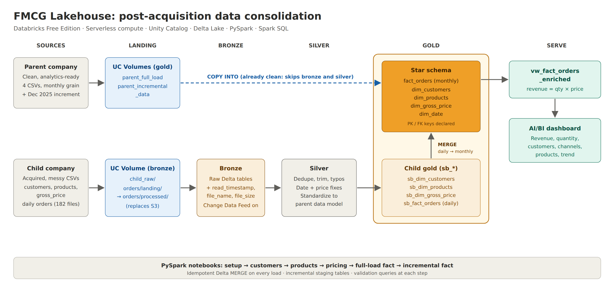

# FMCG Lakehouse on Databricks 

A consumer goods company has just bought a smaller competitor. The parent company's sales data is clean and reporting-ready. The company it acquired keeps its data in messy CSV files: duplicate customers, misspelled cities, dates in several different formats, prices recorded as "unknown" or negative, and orders logged daily instead of monthly. Leadership wants one dashboard showing both businesses together.

This project is how I solved that on Databricks Free Edition. I took the acquired company's raw files through a bronze → silver → gold pipeline, reshaped them to fit the parent company's star schema, merged the two, and built a dashboard on top.

I followed the structure of [this end-to-end Databricks project](https://www.youtube.com/watch?v=U6ZUKWdfSLY), then adapted it to run on my own workspace (more on that below).



## What I used

Databricks on serverless compute, Unity Catalog for governance and storage, Delta Lake tables, PySpark for the transformations, Spark SQL for the loads and checks, and Databricks AI/BI Dashboards for reporting.

## How the data flows

The two companies take different routes, because they start in very different places.

**The parent company** is already clean, so its files skip straight to gold. I created the tables with explicit column types and loaded them with `COPY INTO`.

**The acquired company** goes the long way:

- **Bronze** keeps the files exactly as they arrived, plus three audit columns (when each row was loaded, which file it came from, and how big that file was). If a cleaning rule turns out to be wrong later, I can rebuild everything from here without going back to the source.
- **Silver** is where the cleaning happens: removing duplicates, trimming stray spaces, correcting city typos (Bengaluruu becomes Bengaluru), parsing the mixed date formats, and fixing invalid prices and customer IDs.
- **Gold** reshapes the cleaned data to match the parent's model. That means building columns the acquired company never had (market, platform, channel) and rolling daily orders up to the parent's monthly level. The result is merged into the parent's tables with Delta `MERGE`, so a load can be re-run without creating duplicates.

New data arrives as daily files. The incremental notebook processes only the new files, then recalculates any month they touch, so a late file corrects that month's totals instead of overwriting them.

## The data model

The gold layer is a classic Kimball star schema, something I've built many times in traditional warehouses and wanted to rebuild in a lakehouse:

| Table | What one row represents |
| --- | --- |
| `fact_orders` | Quantity sold for one product, to one customer, in one month |
| `dim_date` | One month |
| `dim_customers` | One customer (both companies) |
| `dim_products` | One product (both companies) |
| `dim_gross_price` | One product's price in one year |

I declared the primary and foreign keys in Unity Catalog, so the relationships are documented and visible in Catalog Explorer. The dashboard reads from a view, `vw_fact_orders_enriched`, which joins everything together and calculates revenue as quantity × price.

## What's in this repository

```
notebooks/1_setup/                      creates the catalog and schemas, builds dim_date, shared variables
notebooks/2_dimension_data_processing/  customers, products and pricing (bronze → silver → gold → merge)
notebooks/3_fact_data_processing/       full load (Jul–Nov 2025) and incremental load (Dec 2025)
sql/                                    volumes, parent loads, enriched view, validation checks, star schema keys
dashboard/                              the dashboard definition (.lvdash.json) and the course reference PDF
docs/                                   architecture diagram (PNG, plus an editable SVG)
```

And here's how it's laid out inside Databricks:

```
Workspace:  /Workspace/Users/<you>/consolidated_pipeline/   (the same three notebook folders)

Unity Catalog:
fmcg/
├── bronze/  child_raw volume (customers/, products/, gross_price/, orders/landing/, orders/processed/)
│            + raw tables: customers, products, gross_price, orders
├── silver/  cleaned tables: customers, products, gross_price, orders
└── gold/    parent_full_load and parent_incremental_data volumes
             star schema: dim_date, dim_customers, dim_products, dim_gross_price, fact_orders
             acquired company's staging tables: sb_dim_customers, sb_dim_products, sb_dim_gross_price, sb_fact_orders
             vw_fact_orders_enriched (the view behind the dashboard)
```

## Running it yourself

1. Run `notebooks/1_setup/setup_catalog`, then `sql/01_volumes.sql`.
2. Upload the parent company's CSVs to `/Volumes/fmcg/gold/parent_full_load/` and run `sql/02_parent_gold_load.sql`.
3. Run `notebooks/1_setup/dim_date_table_creation`.
4. Upload the acquired company's CSVs to `/Volumes/fmcg/bronze/child_raw/`, into `customers/`, `products/`, `gross_price/` and `orders/landing/`.
5. Run the customers, products and pricing notebooks, in that order (pricing depends on products).
6. Run `1_full_load_fact` once. It moves the order files to `processed/` when it's done.
7. Upload the December order files to `orders/landing/`, run `2_incremental_load_fact`, then run `sql/03_parent_incremental.sql` for the parent's December data.
8. Run `sql/04_vw_fact_orders_enriched.sql` and import `dashboard/Performance_Overview.lvdash.json`.
9. Optionally, run `sql/06_star_schema_keys.sql` to declare the keys.

`sql/05_validation_checks.sql` has the checks I ran along the way, with the expected numbers.

## What I changed from the original

The course reads its files from the author's own S3 bucket, which I don't have access to, and this Edition can't connect external cloud storage anyway. So I moved all the raw files into Unity Catalog Volumes and pointed every notebook at those paths instead.

I also switched the notebooks to a relative path (`%run ../1_setup/utilities`), so the project works no matter which workspace folder it lives in, and I created the parent's gold tables with explicit column types so the acquired company's data merges in cleanly.

## Did it work?

Yes. These are the numbers I checked at each stage:

| Check | Result |
| --- | --- |
| Parent company's history in `fact_orders` | 93,055 rows |
| Acquired company's rows added for July–November 2025 | 3,060 |
| December 2025 rows (parent 4,485 + acquired 612) | 5,097 |
| Total rows in `fact_orders` | 101,212 |
| Months in `dim_date` | 24 |

